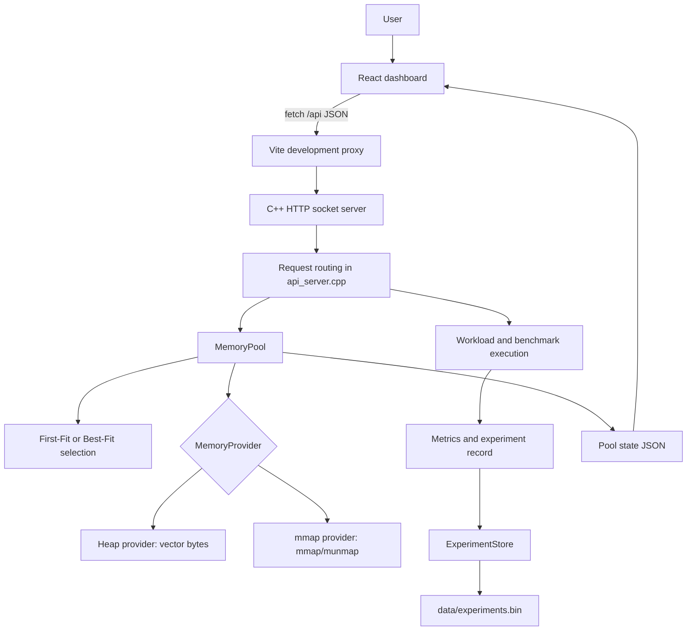
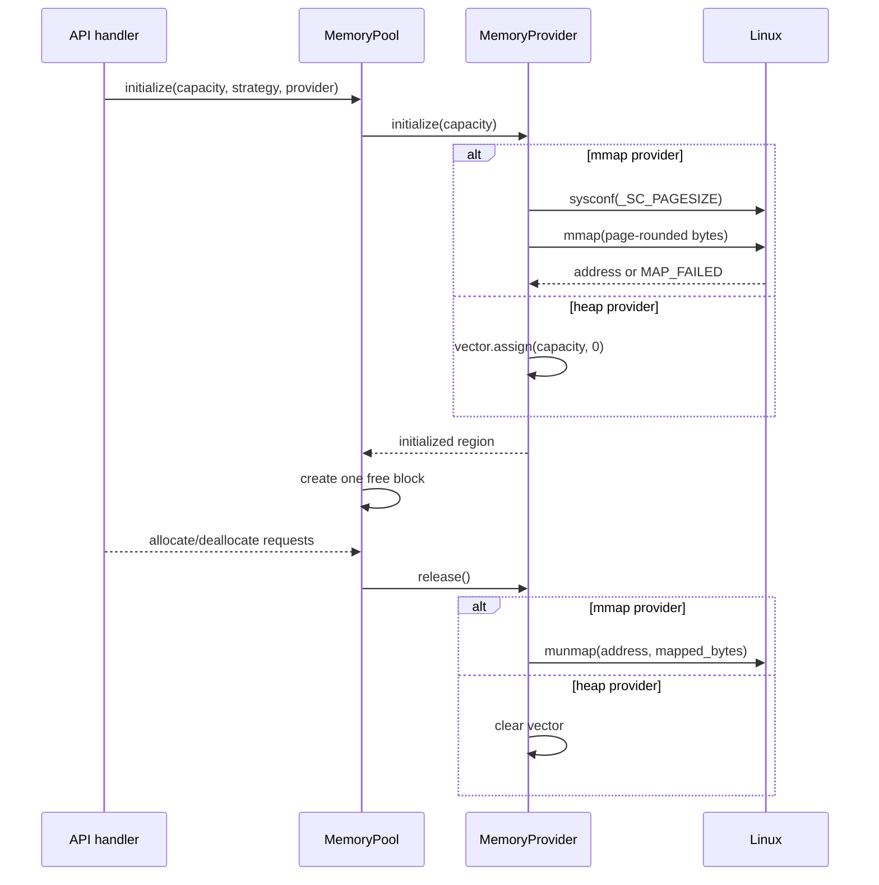
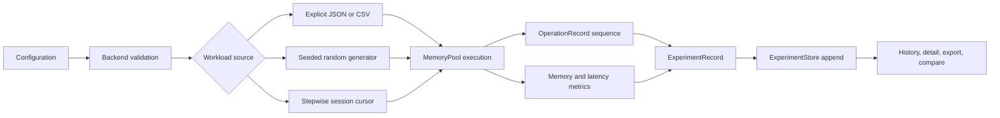

# MemForge: Memory Pool Allocation, Visualization & Performance Analytics Platform

## Documentation status

This document describes the implementation currently present in the repository
at the time of writing. Source code is the primary authority. Features
mentioned in earlier specifications but not visible in the source are marked
as planned, incomplete, or not verified.

The project is a userspace allocator and analysis application. It is not a
kernel module, does not replace Linux `malloc()`, and does not manage physical
memory or other processes.

## 1. Project Overview

MemForge is an interactive memory-pool allocator and performance-analysis
platform. A React dashboard sends allocation, deallocation, workload, and
benchmark requests to a C++ HTTP server. The server owns a `MemoryPool`,
executes allocation algorithms against a selected memory provider, calculates
allocator statistics, and persists completed experiments. The dashboard then
renders the returned block map, metrics, experiment history, comparisons, and
CSV exports.

The project makes allocator behavior observable. A conventional application
usually asks the system allocator for memory and does not expose the internal
free blocks, placement decisions, or fragmentation state. MemForge instead
gives an experiment a bounded pool and records:

- The ordered block layout, represented by offsets from the pool base.
- Allocated and free block sizes.
- Requested versus reserved bytes.
- Allocation and deallocation successes and failures.
- Splitting and coalescing operations.
- Utilization and fragmentation values.
- Operation latency and workload-level measurements.
- Persisted experiment configurations and operation records.

The current implementation supports two memory providers:

1. **Heap provider:** a `std::vector<std::uint8_t>` backing store. This is the
   default and preserves the original behavior.
2. **Linux mmap provider:** an anonymous private read/write mapping obtained
   with `mmap()` and released with `munmap()`. The requested pool capacity is
   retained separately from the page-rounded mapping size.

The allocator algorithms operate on either provider. The provider obtains and
releases the backing region; `MemoryPool` manages blocks inside that region.

### Why a custom pool is useful

A custom pool makes allocation policy and memory layout explicit. First-Fit
and Best-Fit can be compared under equivalent workloads, while splitting and
coalescing can be observed directly. This is useful for teaching memory
management, investigating fragmentation, validating workload assumptions, and
studying the trade-offs between allocation latency and space utilization.

MemForge does not claim that one algorithm is always superior. The result
depends on the pool size, request sequence, allocation mode, and measurement
conditions.

## 2. Problem Statement

Dynamic allocation has several interacting effects:

- Requests must find a sufficiently large free region.
- Allocation can split a larger free region.
- Deallocation can create holes between live allocations.
- Adjacent free regions can be coalesced.
- Fixed-size allocation can reserve more bytes than the user requested.
- A pool may have enough total free bytes but no single contiguous block large
  enough for a request.

These effects are difficult to understand from final success or failure alone.
An allocator experiment therefore needs controlled inputs, operation-level
results, memory snapshots, timing measurements, and a way to compare runs.

MemForge provides that integrated workflow. It does not eliminate
fragmentation or guarantee lower latency. It provides a bounded userspace
environment in which different strategies and workloads can be observed and
measured consistently.

## 3. Project Objectives

The implemented objectives are:

1. Maintain a custom memory pool with explicit block metadata.
2. Support First-Fit and Best-Fit block selection.
3. Support variable-size and fixed-size allocation modes.
4. Validate requests and reject invalid or oversized allocations.
5. Split sufficiently large free blocks.
6. Coalesce adjacent free blocks after deallocation.
7. Track allocation IDs, requested sizes, reserved sizes, and offsets.
8. Execute explicit JSON/CSV workloads.
9. Generate seeded random workloads through the backend.
10. Provide stepwise workload start, step, pause, resume, and reset controls.
11. Collect allocation, deallocation, utilization, fragmentation, and workload
    metrics.
12. Run benchmark and comparison requests.
13. Persist completed experiment records in a versioned local file.
14. Provide a React dashboard with memory visualization, history, charts,
    comparisons, and CSV export.
15. Support an explicit Linux `mmap` provider without removing the heap
    provider.

The repository also contains analysis scripts and documentation assets. Their
execution is not part of the live dashboard request path.

## 4. Scope and Boundaries

### Included

- Userspace allocation inside one configured pool.
- Heap-backed and Linux mmap-backed providers.
- First-Fit and Best-Fit selection.
- Fixed-size and variable-size modes.
- Explicit and seeded random workloads.
- Synchronous workload execution and backend-owned stepwise sessions.
- Live pool state returned as JSON.
- Experiment persistence and retrieval.
- Experiment comparison and CSV export.
- Frontend memory-layout visualization and analytics.

### Not included

- A kernel module or kernel allocator.
- Replacement of the process-wide `malloc()` implementation.
- Physical-page management.
- Allocation of memory belonging to unrelated processes.
- A database server or multi-process persistence coordinator.
- A general-purpose production allocator with thread-safe concurrent access.
- A separate backend framework, controller package, or service package.

`mmap()` provides a userspace virtual-memory mapping. Linux still controls
virtual-to-physical translation and physical memory management. MemForge only
manages offsets and block metadata inside the region it obtained.

## 5. System Architecture

The actual architecture is intentionally compact:



### 5.1 Frontend presentation and interaction

`frontend/src/App.jsx` is the main React application. It owns state for:

- Current pool state and loading/error status.
- Capacity, strategy, fixed block size, and memory provider controls.
- Direct allocation and selected-block deallocation.
- Explicit workload editing and execution.
- Random workload configuration.
- Stepwise workload session controls.
- Experiment history, details, comparison selection, and exports.

`frontend/src/styles.css` defines the dark Electric Coral/Sky Blue dashboard
presentation. The memory layout uses backend block offsets and sizes; it does
not invent allocation state.

### 5.2 API communication

The frontend uses browser `fetch()` calls to `/api` endpoints. During Vite
development, [`vite.config.js`](frontend/vite.config.js) proxies those calls
to `http://localhost:8080` or the `MEMORY_POOL_API_URL` value. The backend
does not use a third-party HTTP framework; it parses HTTP requests received on
a POSIX socket.

### 5.3 Backend routing

`src/api_server.cpp` contains the HTTP server loop, request parsing,
validation, routing, workload execution helpers, JSON serialization, and
history coordination. There are no separate controller or service classes in
the current architecture. The closest equivalent is the set of internal
request handlers and helper functions in this translation unit.

`src/api_server.h` exposes `PoolApiServer`, which owns the configured pool
capacity and listening port. `src/server_main.cpp` creates the server with a
default capacity of 256 KiB and port 8080.

### 5.4 Memory-pool management

`src/memory_pool.h` and `src/memory_pool.cpp` define:

- `AllocationBlock`: block ID, offset, reserved size, requested size,
  allocation ID, and state.
- `MemoryStats`: current and historical allocator metrics.
- `MemoryPool`: provider lifecycle, allocation, deallocation, selection,
  splitting, coalescing, and JSON state generation.

The pool stores metadata in C++ containers. User-visible addresses are not
sent to the frontend; API records use offsets from the provider base.

### 5.5 Allocation algorithm layer

The placement logic is implemented by `MemoryPool::find_first_fit()` and
`MemoryPool::find_best_fit()` in `src/memory_pool.cpp`. The separate
`src/first_fit.*` and `src/best_fit.*` files are part of the project layout,
but the active `MemoryPool` selection path uses its internal selection
functions.

- First-Fit scans blocks in order and returns the first suitable free block.
- Best-Fit scans suitable free blocks and returns the smallest one.

### 5.6 Memory provider layer

`src/memory_provider.h` defines the provider interface:

```cpp
initialize(requested_bytes)
release()
data()
capacity()
mapped_bytes()
name()
```

`src/memory_provider.cpp` implements:

- `HeapMemoryProvider`, using `std::vector<std::uint8_t>`.
- `MmapMemoryProvider`, using `sysconf(_SC_PAGESIZE)`, page rounding,
  `mmap(nullptr, ..., PROT_READ | PROT_WRITE, MAP_PRIVATE | MAP_ANONYMOUS, -1, 0)`,
  `MAP_FAILED` validation, and `munmap()`.

The provider is selected with `MemoryProviderType`. Heap is the default.
Mapping failure returns failure to the pool; it does not silently allocate a
replacement heap buffer.

### 5.7 Experiment execution and metrics

`api_server.cpp` creates `ExperimentRecord` values for explicit, random, and
stepwise workloads. `src/experiment_metrics.*` defines operation records,
latency statistics, memory snapshots, fragmentation metrics, workload metrics,
benchmark rows, CSV helpers, and comparison helpers.

`src/benchmark.cpp` runs repeated allocation/deallocation samples using a
fresh `MemoryPool`, measures elapsed times with `std::chrono`, and computes
success rates, utilization, fragmentation, percentile latency, throughput,
splitting, and coalescing values.

### 5.8 Persistence

`src/experiment_store.*` implements a local append-only text serialization
format with the header `MEMORY_POOL_EXPERIMENTS_V1`. Records are length
delimited and use quoted strings. Startup loads all records; malformed or
truncated records cause a clear load failure. The path is configured with
`MEMORY_POOL_EXPERIMENTS_PATH`, defaulting to `data/experiments.bin`.

The store is intended for one backend process. The source does not implement
multi-process locking or an explicit fsync protocol.

## 6. Project Directory Structure

```text
MemForge/
├── CMakeLists.txt
├── README.md
├── Project_Details.md
├── DEVELOPMENT_LOG.md
├── DEVELOPMENT.md
├── PROJECT_DOCUMENTATION.md
├── run_dashboard.sh
├── src/
│   ├── api_server.cpp
│   ├── api_server.h
│   ├── benchmark.cpp
│   ├── benchmark.h
│   ├── best_fit.cpp
│   ├── best_fit.h
│   ├── experiment_metrics.cpp
│   ├── experiment_metrics.h
│   ├── experiment_store.cpp
│   ├── experiment_store.h
│   ├── first_fit.cpp
│   ├── first_fit.h
│   ├── fixed_size_pool.cpp
│   ├── fixed_size_pool.h
│   ├── main.cpp
│   ├── memory_pool.cpp
│   ├── memory_pool.h
│   ├── memory_provider.cpp
│   ├── memory_provider.h
│   ├── server_main.cpp
│   └── variable_size_pool.cpp/.h
├── tests/
│   └── allocator_tests.cpp
├── frontend/
│   ├── index.html
│   ├── package.json
│   ├── package-lock.json
│   ├── vite.config.js
│   ├── src/
│   │   ├── App.jsx
│   │   ├── comparisonCsv.js
│   │   ├── experimentDashboard.js
│   │   ├── main.jsx
│   │   ├── randomWorkload.js
│   │   ├── styles.css
│   │   └── workloadCsv.js
│   └── test/
│       ├── experimentDashboard.test.js
│       ├── randomWorkload.test.js
│       └── workloadCsv.test.js
├── analysis/
│   ├── analyze_results.py
│   └── generate_graphs.py
├── documentation/
│   ├── FEATURE_INVENTORY.md
│   ├── FUNCTIONALITY_DOCUMENTATION.md
│   ├── LIMITATIONS.md
│   └── observations/
└── data/
    └── experiments.bin
```

Build directories, frontend dependencies, and generated frontend assets are
environment outputs and are not part of the source architecture.

## 7. Technologies

| Area | Technology actually used | Purpose |
|---|---|---|
| Frontend | React 18 | Interactive dashboard and state management |
| Frontend build | Vite 5 | Development server, proxy, and production bundle |
| Styling | Plain CSS | Dashboard theme, layout, charts, and responsive behavior |
| Backend | C++17 | Allocator, HTTP server, workloads, metrics, persistence |
| HTTP transport | POSIX sockets | Lightweight request/response server |
| Heap provider | `std::vector<std::uint8_t>` | Existing in-process backing storage |
| OS provider | Linux `mmap`, `munmap`, `sysconf` | Explicit virtual-memory mapping |
| Persistence | Versioned local append-only file | Experiment history |
| Build | CMake | C++ targets and CTest registration |
| Tests | CTest and Node built-in test runner | C++ regression and frontend utility tests |
| Visualization | React, CSS, and inline SVG/HTML primitives | Memory map, charts, summaries |

No database, chart library, Redux store, or backend framework is declared in
the project manifests.

## 8. Memory Allocator Design

### 8.1 Block representation

`AllocationBlock` contains:

| Field | Meaning |
|---|---|
| `block_id` | Metadata identity for the block |
| `offset` | Byte offset from the provider base |
| `size` | Reserved block size used by the allocator |
| `requested_size` | User request size for an allocated block |
| `allocated` | Whether the block is live |
| `allocation_id` | Workload-visible allocation identity |
| `state` | `"allocated"` or `"free"` |

The frontend uses these offsets and sizes to render proportions without
exposing process addresses.

### 8.2 Initialization

Initialization validates non-zero capacity and fixed-mode block size, asks the
provider for backing storage, resets counters, and creates one free block
covering the entire requested capacity.

For mmap, the actual OS mapping can be larger than the logical pool because
the mapping is rounded to a system page boundary. Allocation remains bounded
by the logical capacity.

### 8.3 Allocation lifecycle

1. Reject an uninitialized pool, zero request, or request larger than capacity.
2. In fixed mode, reject a request larger than the configured block size.
3. Use the fixed block size or the requested size as the logical allocation
   size.
4. Round the allocation size to an 8-byte boundary.
5. Select a free block with First-Fit or Best-Fit.
6. Mark the candidate allocated and record the requested size.
7. If the remainder is at least 16 bytes, insert a new free block.
8. Refresh the free-block snapshot and update counters.
9. Return the provider address plus the block offset.

The implementation does not add a separate in-pool allocation header. The
allocator's metadata is held in C++ containers.

### 8.4 Deallocation lifecycle

1. Reject a null pointer or released/uninitialized pool.
2. Convert the pointer to an integer address and verify it lies within the
   provider region.
3. Find an allocated block whose offset matches the pointer.
4. Mark it free and clear its allocation metadata.
5. Sort blocks by offset.
6. Merge adjacent free blocks.
7. Refresh the free-block list and increment deallocation/coalescing counters.

An invalid pointer or repeated deallocation returns `false` and does not alter
the block list.

### 8.5 Fixed-size and variable-size modes

In variable mode, the reserved size is the aligned request size. In fixed
mode, a request such as 37 bytes can reserve a 64-byte block; requested bytes
remain 37 and the difference contributes to internal fragmentation. Requests
larger than the fixed block are rejected.

### 8.6 Fragmentation formulas

The current `MemoryPool::stats()` implementation calculates:

- Allocated bytes: sum of `size` for allocated blocks.
- Requested bytes: sum of `requested_size` for allocated blocks.
- Free bytes: sum of `size` for free blocks.
- Utilization: `allocated_bytes / total_capacity`.
- Internal fragmentation bytes:
  `max(allocated_bytes - requested_bytes, 0)`.
- Internal fragmentation percent:
  `internal_fragmentation_bytes / requested_bytes * 100`.
- External fragmentation:
  `1 - largest_free_block / free_bytes`, or zero when no free bytes exist.

The API and frontend use fractions for some utilization metrics and percentages
for display. Readers should check field names and presentation conversions
before comparing values.

## 9. Memory Provider Lifecycle



`mapping_count` and `unmapping_count` are pool counters for provider
initialization and successful release operations. They are diagnostic
accounting values, not operating-system global mapping counts.

## 10. Backend API

Every response uses the common shape:

```json
{
  "success": true,
  "message": "Human-readable result",
  "payload": {}
}
```

The following routes are present in `src/api_server.cpp`.

| Method and route | Purpose |
|---|---|
| `POST /api/pool/initialize` | Replace the live pool with a requested capacity, strategy, mode, fixed block size, and provider |
| `GET /api/pool/state` | Return block layout, strategy, provider, mapping size, and statistics |
| `GET /api/statistics` | Return a compact statistics response |
| `POST /api/pool/reset` | Release and recreate the current pool |
| `POST /api/allocate` | Allocate a direct request and return pool state |
| `POST /api/free` | Free a direct allocation by allocation ID |
| `POST /api/workload/session/start` | Start a backend-owned stepwise workload |
| `GET /api/workload/session/status` | Read stepwise session state |
| `POST /api/workload/session/pause` | Pause a running session |
| `POST /api/workload/session/resume` | Resume a paused session |
| `POST /api/workload/session/step` | Execute one operation and persist on completion |
| `POST /api/workload/session/reset` | Clear the live stepwise session |
| `POST /api/workload/execute` | Execute and persist an explicit workload |
| `POST /api/workload/random` | Generate, execute, and persist a seeded random workload |
| `POST /api/benchmark` | Run benchmark/comparison requests |
| `GET /api/experiments` | List persisted experiment summaries |
| `DELETE /api/experiments` | Clear persisted experiment history |
| `GET /api/experiments/detail?id=...` | Return one experiment |
| `GET /api/experiments/export?...` | Export an experiment section as CSV |
| `POST /api/experiments/compare` | Compare selected persisted experiments |

### Provider selection

Pool initialization and workload requests accept `"memory_provider": "heap"` or
`"memory_provider": "mmap"`. Empty provider input defaults to heap in the
backend helper. The dashboard exposes the same choice as **Heap** or
**Linux mmap**.

### Example mmap request

```bash
curl -X POST http://localhost:8080/api/pool/initialize \
  -H 'Content-Type: application/json' \
  -d '{"capacity":5000,"strategy":"best_fit","memory_provider":"mmap"}'
```

The response contains the logical capacity, the page-rounded `mapped_bytes`,
and `"memory_provider": "mmap"`.

## 11. Workload and Experiment Lifecycle



Explicit workloads contain `allocate` and `free` operations. Allocation
records use an allocation ID; a zero ID can be assigned by the backend.
Frontend CSV utilities validate headers, quoting, sizes, operations, IDs, and
free references before producing a request.

Random workloads use a seed, operation count, size range, and allocation versus
deallocation probabilities. The backend validates that probabilities total
100 percent and that fixed-mode requests fit the fixed block.

Stepwise sessions hold a global in-process session containing a workload
cursor, pool, active allocation pointers, results, configuration, and status.
Completion creates and persists an experiment record.

## 12. Metrics and Benchmarking

### Operation and workload metrics

`OperationRecord` records the operation, allocation ID, requested and actual
size, offset, success, latency, and error message. Workload metrics aggregate
operation counts, successful/failed operations, duration, request-size
distribution, peak active allocations, and total requested bytes.

### Latency metrics

`AllocationLatencyStats` records request counts, total, average, median, min,
max, P95, P99, success rate, and failure rate. The benchmark implementation
uses `std::chrono::steady_clock`. It measures allocation and deallocation
calls separately and measures total workload execution duration separately.

### Benchmark behavior

`benchmark_pool()` creates a fresh heap-backed `MemoryPool` for each benchmark
run. It performs the configured request sequence for the requested iterations,
then deallocates live pointers. The current benchmark API does not expose a
provider argument, so benchmark comparison is currently heap-backed even
though normal pool and workload endpoints support mmap.

`compare_allocator_algorithms()` returns rows for requested strategy names.
The frontend compares up to four persisted experiments and warns when
capacities, modes, fixed block sizes, workload signatures, settings, or seeds
differ.

## 13. Frontend Dashboard

The main dashboard in `frontend/src/App.jsx` includes:

- Pool controls for capacity, strategy, fixed block size, and provider.
- Direct allocate/free/reset controls.
- Provider, mapped-byte, capacity, free-byte, allocated-byte, and utilization
  summaries.
- A proportional memory map with allocated/free/selected block states.
- Selected allocation details and backend-provided block metadata.
- Explicit workload editing and execution.
- Seeded random workload controls.
- Stepwise session controls and operation results.
- Experiment history, detail views, and history clearing.
- Comparison selection, condition warnings, metric cards, graphs, and CSV
  export.

`frontend/src/experimentDashboard.js` defines comparison metric metadata,
condition-difference detection, formatting, deltas, graph groups, and the
four-experiment selection limit.

`frontend/src/workloadCsv.js`, `randomWorkload.js`, and `comparisonCsv.js`
provide client-side validation or export formatting. These utilities do not
perform allocation and are not authoritative for allocator state.

The visualization uses actual backend blocks. When the backend is unavailable,
the app shows loading/error state rather than claiming that an empty pool is
the current state.

## 14. Persistence and Compatibility

The persistence layer stores experiment records in an append-only local file.
It serializes workload operations, metrics, benchmark rows, final JSON state,
and errors. The file format is versioned with a V1 header and uses quoted
strings to preserve spaces and special characters.

The store has size and collection-count limits and reports malformed or
truncated files as startup errors. It does not silently discard invalid
history.

### Current implementation inconsistency

`ExperimentRecord` now contains `memory_provider`, and live/new API JSON
responses expose it. However, `src/experiment_store.cpp` currently serializes
the older record field sequence without separately writing or reading
`memory_provider`. Therefore:

- Existing history remains readable using the current format.
- Provider metadata is available in live state and new response payloads.
- Provider identity is not yet independently persisted in the binary-like
  experiment history record.
- A future storage-format version or backward-compatible extension is needed
  if provider-specific historical comparison is required.

This is documented as an implementation gap, not as a completed persistence
feature.

## 15. Build, Run, and Test

### C++ build

```bash
cmake -S . -B build
cmake --build build
ctest --test-dir build --output-on-failure
```

`CMakeLists.txt` builds:

- `memory_pool_lib`
- `memory_pool_demo`
- `memory_pool_server`
- `allocator_tests`

### Frontend

```bash
cd frontend
npm ci
npm test
npm run build
```

The frontend test command is Node's built-in test runner. The package declares
React, React DOM, Vite, and the Vite React plugin.

### Dashboard

```bash
./build/memory_pool_server 8080
cd frontend
npm run dev -- --host 0.0.0.0
```

The default Vite port is 3000 and the default backend port is 8080.
`run_dashboard.sh` starts the two services together. The backend history path
can be changed with `MEMORY_POOL_EXPERIMENTS_PATH`.

## 16. Testing Coverage

`tests/allocator_tests.cpp` covers initialization, direct allocation and
deallocation, invalid requests, double-free behavior, fixed-size accounting,
strategy selection, benchmark calculations, persistence round trips, and the
Linux mmap provider.

The frontend tests cover comparison selection and conditions, metric
formatting/deltas, random workload validation, API payload construction, CSV
parsing, CSV validation, and export behavior.

The repository contains automated regression tests, but the source does not
provide a complete concurrency test suite, a cross-platform mmap abstraction,
or a persistent-provider-metadata migration test.

## 17. Confirmed Limitations and Gaps

### Confirmed

- Backend state and stepwise session state are process-local.
- The HTTP server is a lightweight custom socket implementation.
- Persistence is a local append-only file intended for one backend process.
- No explicit multi-process file locking or fsync guarantee is implemented.
- `memory_provider` is not independently serialized by the current experiment
  store format.
- Benchmark helper functions currently construct heap-backed pools.
- The allocator is not documented or tested as thread-safe.
- mmap support is Linux-specific.
- The dashboard uses custom CSS/SVG/HTML visualization rather than a chart
  library.

### Incomplete or not represented as current features

- Kernel-level allocation and physical-memory management are not implemented.
- Provider-specific historical comparison is not complete.
- No separate backend controller/service modules exist.
- No claim of production-grade durability or concurrent multi-user operation
  is supported by the source.

### Potential improvements

- Add a versioned persistence extension for provider and mapped-byte fields.
- Add provider selection to benchmark APIs and comparison records.
- Add concurrency protection around all live allocator state.
- Replace ad hoc HTTP parsing with a carefully validated HTTP component if
  broader protocol support is required.
- Add tests for mapping failure, release failure, and storage migration.
- Add workload patterns beyond the current explicit and seeded random forms.
- Add OS memory information only if it can be clearly distinguished from
  allocator-owned pool statistics.

## 18. Future Enhancements

Reasonable future work, consistent with the existing architecture, includes:

1. Provider-aware benchmark and comparison execution.
2. Backward-compatible persistence version 2 with explicit provider fields.
3. Thread-safe pools and isolated sessions for concurrent clients.
4. More workload generators, including burst, alternating, and locality-based
   patterns.
5. More allocator policies, such as next-fit or segregated free lists.
6. Additional visualization for allocation timelines and fragmentation
   evolution.
7. Stronger API parsing and structured validation.
8. More detailed test coverage for failure paths and platform behavior.
9. Optional Linux `/proc` or `smaps` observations, clearly separated from
   MemForge-owned pool accounting.

These are recommendations, not current capabilities.

## 19. Source Reference Table

| Area | Source | Important symbols or content |
|---|---|---|
| Server entry point | `src/server_main.cpp` | `main()` |
| HTTP server | `src/api_server.cpp`, `src/api_server.h` | `PoolApiServer::run()` and route handlers |
| Pool | `src/memory_pool.cpp`, `src/memory_pool.h` | `MemoryPool`, `MemoryStats`, `AllocationBlock` |
| Providers | `src/memory_provider.cpp`, `src/memory_provider.h` | `HeapMemoryProvider`, `MmapMemoryProvider`, provider factory |
| Benchmarking | `src/benchmark.cpp`, `src/benchmark.h` | `benchmark_pool()`, `compare_allocator_algorithms()` |
| Metrics | `src/experiment_metrics.cpp`, `src/experiment_metrics.h` | `ExperimentRecord`, latency and CSV helpers |
| Persistence | `src/experiment_store.cpp`, `src/experiment_store.h` | `ExperimentStore::load()`, `append()`, `clear()` |
| Frontend | `frontend/src/App.jsx` | Dashboard state, requests, controls, visualization |
| Frontend utilities | `frontend/src/*.js` | Workload, random, comparison, and CSV helpers |
| Frontend tests | `frontend/test/*.test.js` | Utility and validation tests |
| C++ tests | `tests/allocator_tests.cpp` | Allocator, benchmark, persistence, mmap regressions |
| Build | `CMakeLists.txt`, `frontend/package.json` | C++ and frontend targets/scripts |

## 20. Glossary

| Term | Meaning in MemForge |
|---|---|
| Memory pool | A bounded region managed by `MemoryPool` and divided into metadata-tracked blocks |
| Heap | The existing process-backed provider implemented with a byte vector |
| `mmap` | Linux system call used here to obtain an anonymous private virtual-memory mapping |
| `munmap` | Linux system call used to release the mmap region |
| Allocation | Reserving a free block for a requested number of bytes |
| Deallocation | Returning an allocated block to the pool |
| Free list | The pool's refreshed collection of currently free block snapshots |
| First-Fit | Selection of the first suitable free block in block order |
| Best-Fit | Selection of the smallest suitable free block |
| Internal fragmentation | Reserved bytes that exceed requested bytes within allocated blocks |
| External fragmentation | Distribution of free bytes across separated blocks, represented by the current ratio formula |
| Block splitting | Dividing a sufficiently large free block into an allocated block and a remainder |
| Block coalescing | Merging adjacent free blocks |
| Workload | An ordered sequence of allocate/free operations |
| Experiment | A persisted workload result with configuration, operations, metrics, and final state |
| Memory utilization | Allocated reserved bytes divided by logical pool capacity |
| Allocation latency | Measured time for an allocation request |
| API | HTTP request/response interface between the dashboard and C++ server |
| Persistence | Saving and loading experiment records from `data/experiments.bin` or a configured path |
| Provider | Component responsible for obtaining, exposing, and releasing pool backing storage |

