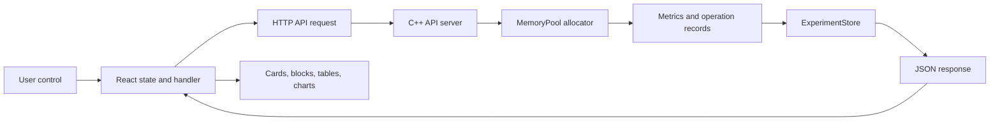

# Custom Memory Pool Allocator

## Dashboard Feature Guide

**Purpose:** A beginner-friendly and technically accurate guide to the implemented React dashboard, C++ allocator, API, experiments, metrics, and demonstrations.

**Evidence policy:** This guide describes the current source and verified behavior. Numerical examples marked *Illustrative example* are not measurements from a real run.

## 1. Project overview

The project is a C++ memory-pool allocator with a React/Vite dashboard. A memory pool is a pre-reserved byte region managed by the application. Instead of asking the operating system for every allocation, the allocator finds and reuses blocks inside that region. The dashboard makes the allocator observable: it shows the pool layout, executes workloads, measures latency and fragmentation, stores experiments, and compares actual saved results.

The implementation has two independent decisions:

| Decision | Available values | Meaning |
|---|---|---|
| Placement algorithm | First-Fit, Best-Fit | Which free block is selected |
| Allocation mode | Variable-size, Fixed-size | How much space an accepted request reserves |

The frontend is in `frontend/src/App.jsx` and `frontend/src/styles.css`. The HTTP server is in `src/api_server.cpp`. Core allocator behavior is in `src/memory_pool.cpp`, with strategy and mode support in the related `src/*_pool.cpp` and `src/*_fit.cpp` files.

## 2. Dashboard navigation

The current application is a single-page dashboard rather than a multi-route website. Its visible sections are:

1. **Pool configuration and controls** — initialize capacity, choose algorithm and mode, and reset the pool.
2. **Memory pool visualization** — inspect free and allocated blocks.
3. **Statistics and metric cards** — view capacity, usage, utilization, fragmentation, and operation counters.
4. **Workload editor** — enter JSON, import CSV, download a template, run a workload, and export results.
5. **Seeded random workload** — configure operations, size limits, probabilities, seed, algorithm, mode, and fixed block size.
6. **Benchmark comparison** — execute backend measurements for allocator configurations.
7. **Experiment history** — select, inspect, export, compare, and clear saved records.
8. **Allocated memory space** — tabular view of current live blocks.
9. **Workload comparison analytics** — actual backend comparison rows rendered as bars or trends.

There is no separate AI-agent page, multi-page router, or WebSocket-driven live dashboard. The “AI workflow dashboard” requirement is therefore **not implemented**, not hidden behind a UI label.

## 3. Feature inventory

| Feature | Location | Status | Evidence |
|---|---|---|---|
| Pool initialization | Configuration panel | Fully implemented and verified | `POST /api/pool/initialize` |
| Manual allocation/free | Pool controls | Fully implemented and verified | `POST /api/allocate`, `POST /api/free` |
| Memory visualization | Pool panel | Fully implemented and verified | `GET /api/pool/state` |
| First-Fit and Best-Fit | Configuration and seeded workload | Fully implemented and verified | `MemoryPool::allocate` strategy selection |
| Fixed and variable modes | Configuration and seeded workload | Fully implemented and verified | `MemoryPool::AllocationMode` |
| Custom JSON/CSV workload | Workload editor | Fully implemented and verified | `POST /api/workload/execute` |
| Seeded random workload | Random workload panel | Fully implemented and verified | `POST /api/workload/random` |
| Stepwise session controls | Workload editor | Implemented, process-local limitation | Session endpoints in `src/api_server.cpp` |
| Benchmark comparison | Benchmark panel | Fully implemented and verified | `POST /api/benchmark` |
| History persistence | History panel | Implemented, single-process file limitation | `ExperimentStore` |
| Experiment comparison | History and analytics | Fully implemented and verified | `POST /api/experiments/compare` |
| CSV export | History/workload controls | Fully implemented and verified | `/api/experiments/export` and workload export |
| Clear all history | History panel | Fully implemented and verified | `DELETE /api/experiments` |
| AI-agent orchestration | No current page | Not implemented | No agent runtime or endpoint exists |
| WebSocket/SSE real-time updates | No current page | Not implemented | Refresh is request-driven |

## 4. Pool configuration and memory visualization

Initialize a pool with a capacity up to 64 MiB. The backend creates a `MemoryPool` backed by a byte vector and starts with one free block. The visualization receives the serialized state from `/api/pool/state`. Each block includes an ID, offset, reserved size, requested size, allocation ID, and state.

Allocated blocks are shown separately from free blocks. The allocated-memory table reports block ID, allocation ID, offset, requested bytes, reserved bytes, internal overhead, and status. A selected allocation can be highlighted without changing allocator state.

When a request uses part of a free block, the allocator splits the free block. When adjacent free blocks become available after deallocation, the allocator coalesces them. This is why the visualization can change from one large block to several blocks and later return to a larger contiguous free region.

**Illustrative example (not measured):**

```text
Initial:       [ free 1000 ]
allocate 200:  [ used 200 ][ free 800 ]
allocate 300:  [ used 200 ][ used 300 ][ free 500 ]
free first:    [ free 200 ][ used 300 ][ free 500 ]
free second:   [          free 1000          ]  <- coalescing
```

Variable-size mode reserves the request size (subject to allocator rules). Fixed-size mode reserves the configured block size for every accepted request and preserves the requested size for internal-fragmentation accounting. A request larger than the fixed block is rejected.

## 5. Allocation strategies

### First-Fit

First-Fit scans free blocks from the beginning and chooses the first block large enough. It is simple and often has low search overhead, but it may leave small fragments near the front of the pool.

### Best-Fit

Best-Fit scans eligible free blocks and chooses the smallest one that can satisfy the request. It can reduce the immediate remainder for some patterns, but the scan may cost more and can create many tiny unusable fragments.

Both strategies use the same allocation, split, free, and coalescing machinery. They are not separate duplicated allocators. A strategy can therefore be compared fairly by keeping capacity, mode, workload sequence, and seed equal.

**Illustrative comparison (not measured):**

```text
Free blocks: [100][300][600], request 250
First-Fit -> chooses 300, leaves 50
Best-Fit  -> chooses 300, leaves 50

Free blocks: [500][280][900], request 250
First-Fit -> chooses 500, leaves 250
Best-Fit  -> chooses 280, leaves 30
```

Neither strategy is always faster or less fragmented. Workload shape determines the result.

## 6. Workload execution

A workload is an ordered list of allocation and deallocation requests. Each row contains an operation, a size, and an allocation ID. Allocation IDs connect a later `free` request to the allocation it should release.

### Custom workload

The editor accepts validated JSON and CSV. CSV must use the exact header `operation,size,allocation_id`; malformed rows, invalid IDs, unsupported operations, and unresolved frees are rejected before execution. Imports are limited to 1 MiB.

`POST /api/workload/execute` executes the sequence against actual allocator calls. The response includes operation results, timings, final state, configuration, and persisted experiment information.

### Seeded random workload

The random panel preserves:

- operations
- minimum bytes
- maximum bytes
- allocation probability
- deallocation probability
- seed

It additionally selects the placement algorithm and allocation mode. Fixed-size mode exposes a fixed block size and validates it against the maximum request. The backend generates the sequence and executes it using the selected configuration; it does not silently replace Best-Fit with First-Fit. Equal seed/settings produce an equivalent generated sequence across compatible configurations, although allocation success can differ.

### Stepwise execution

The dashboard also exposes a backend-owned session:

| Endpoint | Behavior |
|---|---|
| `POST /api/workload/session/start` | Validates configuration and creates a live allocator/session cursor |
| `GET /api/workload/session/status` | Returns status, progress, configuration, results, and current pool state |
| `POST /api/workload/session/step` | Executes exactly the next operation |
| `POST /api/workload/session/pause` | Pauses a running session |
| `POST /api/workload/session/resume` | Marks a paused session running |
| `POST /api/workload/session/reset` | Drops only the active session |

Completion persists one experiment. The session is process-local and supports one active session at a time. The original synchronous endpoint remains available.

## 7. Metrics reference

| Metric | Unit/formula | Interpretation |
|---|---|---|
| Pool capacity | bytes | Total reserved pool size |
| Allocated memory | bytes | Reserved bytes currently used |
| Requested memory | bytes | User-requested bytes currently represented |
| Free memory | bytes | Capacity minus allocated bytes |
| Memory utilization | allocated / capacity | Higher means more of the pool is occupied |
| Total operations | count | Workload operation count |
| Successful/failed allocations | count | Actual allocator outcomes |
| Allocation success rate | successful allocations / allocation requests | Higher indicates more accepted requests |
| Average latency | milliseconds | Mean measured operation latency |
| Median/P50 | milliseconds | Half of samples are at or below this value |
| P95 | milliseconds | 95% of samples are at or below this value |
| P99 | milliseconds | 99% of samples are at or below this value |
| Maximum latency | milliseconds | Slowest measured operation |
| Internal fragmentation | bytes/percent | Reserved space minus requested space, especially visible in fixed mode |
| External fragmentation | ratio/percent | Fragmentation of free space across separated blocks |
| Largest free block | bytes | Largest contiguous free region |
| Free block count | count | Number of free regions |
| Splitting/coalescing operations | count | Structural allocator actions |

Latency percentiles are derived from recorded allocation samples by the metrics/benchmark implementation. They are not invented by the frontend. A missing metric remains unavailable in comparison data rather than being replaced with a fabricated value.

## 8. Experiment history and persistence

An experiment is a saved execution record containing configuration, workload signature, operation sequence, allocator outcomes, metrics, final memory JSON, and benchmark information. Records are appended to a versioned local binary file, defaulting to `data/experiments.bin`; `MEMORY_POOL_EXPERIMENTS_PATH` selects another file.

History is loaded when the backend starts. A malformed or truncated file causes an explicit startup error rather than silent replacement. The store is intended for one backend process and does not provide multi-process locking, transactional updates, or an explicit fsync guarantee. Records can be viewed, compared, exported, or cleared; individual record editing is not implemented.

To reproduce an experiment, open its details, note capacity, strategy, mode, fixed block size, workload settings, and seed, then run the same configuration. The comparison API checks compatibility and flags mismatched conditions.

## 9. Comparison analytics

Select up to four saved experiments. When at least two IDs are selected, the frontend requests `/api/experiments/compare`. The backend returns actual comparison rows. The first selected experiment is the baseline for deltas.

Available graph groups include:

| Chart group | Horizontal dimension | Values | Use |
|---|---|---|---|
| Allocation performance | Experiment/configuration | total, average, median, P95, P99 latency | Compare speed and tail latency |
| Memory utilization | Experiment/configuration | peak/final utilization, allocated/free bytes | Compare pool occupancy |
| Fragmentation | Experiment/configuration | internal/external fragmentation, largest free block, free block count | Compare memory quality |
| Allocation success | Experiment/configuration | successful/failed allocations and rates | Compare workload outcomes |

The chart type selector changes the presentation between grouped bars and line trends; it does not create new data. Metric and legend/value toggles affect display only. CSV export uses the comparison response. Refresh re-reads saved history and retries the backend comparison. Workload/capacity/mode mismatches are shown as conditions so an unfair comparison is visible.

## 10. Real-time update behavior

The application uses request-driven updates, not WebSockets, SSE, or timed polling. Pool state refreshes after relevant actions. History refreshes after execution or explicit refresh. Comparison analytics refreshes on selection changes, refresh, or retry. During a long synchronous workload, the frontend does not receive a stream of per-operation updates. Stepwise sessions provide explicit progress after each request.

## 11. Backend API data flow



Important routes:

| Operation | Method and route | Result |
|---|---|---|
| Initialize | `POST /api/pool/initialize` | Configures the live pool |
| State | `GET /api/pool/state` | Returns blocks and statistics |
| Statistics | `GET /api/statistics` | Returns allocator statistics |
| Allocate/free | `POST /api/allocate`, `POST /api/free` | Performs actual operation |
| Custom workload | `POST /api/workload/execute` | Executes and saves sequence |
| Random workload | `POST /api/workload/random` | Generates, executes, and saves seeded sequence |
| Benchmark | `POST /api/benchmark` | Measures actual allocator behavior |
| History | `GET /api/experiments` | Lists persisted summaries |
| Detail | `GET /api/experiments/detail?id=...` | Returns complete record |
| Compare | `POST /api/experiments/compare` | Returns actual comparison rows |
| Export | `GET /api/experiments/export?...` | Downloads saved data |
| Clear history | `DELETE /api/experiments` | Clears in-memory and persisted history |

## 12. Controls reference

| Control | Location | Purpose | Backend action |
|---|---|---|---|
| Initialize pool | Configuration | Create capacity/mode/strategy | `POST /api/pool/initialize` |
| Reset pool | Pool controls | Clear live allocator state | `POST /api/pool/reset` |
| Allocate/free | Pool controls | Manual operation | Corresponding API route |
| Run workload | Workload editor | Execute whole sequence | `POST /api/workload/execute` |
| Start stepwise | Workload editor | Create session | Session start route |
| Step/Pause/Resume/Reset | Workload editor | Control session | Session routes |
| Import CSV | Workload editor | Validate and load file | Frontend validation |
| Download template | Workload editor | Provide valid CSV shape | Frontend download |
| Export CSV | Workload editor/history | Download actual results | Backend export or local workload export |
| Run benchmark | Benchmark section | Measure configurations | `POST /api/benchmark` |
| Select experiment | History | Open detail or comparison | Detail/compare request |
| Clear history | History | Delete all records after confirmation | `DELETE /api/experiments` |
| Metric/chart selectors | Analytics | Change visualization | Frontend display only |
| Refresh comparison | Analytics | Re-fetch actual rows | History + compare routes |

## 13. Beginner-friendly walkthrough

1. Start the C++ server and the Vite frontend.
2. Initialize a pool with a capacity large enough for the intended requests.
3. Choose First-Fit or Best-Fit and choose fixed or variable mode.
4. Use the workload editor or seeded random panel.
5. For a first demonstration, use a small custom sequence: allocate, allocate, free, allocate.
6. Run it and watch the block layout and statistics.
7. Explain that splitting creates a new free remainder and coalescing joins adjacent free blocks.
8. Open history to review the saved configuration and metrics.
9. Repeat the same workload with the other strategy.
10. Select both records and inspect actual comparison rows and charts.
11. Export the experiment or comparison CSV for presentation evidence.

## 14. Practical demonstrations

### Demonstration 1: Basic allocation

**Purpose:** Show pool initialization, allocation, splitting, and state reporting.  
**Steps:** Initialize; submit two allocations; refresh state; free one allocation.  
**Expected behavior:** Allocated and free blocks change, IDs remain associated with operations, and statistics update.  
**Presentation point:** The dashboard visualizes actual allocator state, not a mock animation.

### Demonstration 2: Strategy comparison

**Purpose:** Compare First-Fit and Best-Fit fairly.  
**Steps:** Use the same capacity, variable-size mode, custom workload, and seed/settings where relevant; execute once per strategy; select both records.  
**Expected behavior:** The backend returns separate actual rows and identifies condition differences.  
**Presentation point:** Strategy is independent from allocation mode.

### Demonstration 3: Fragmentation

**Purpose:** Show why request order matters.  
**Steps:** Allocate several differently sized blocks, free non-adjacent blocks, then request a larger block.  
**Expected behavior:** Total free bytes may be sufficient while the largest contiguous block is insufficient.  
**Presentation point:** External fragmentation concerns contiguity, not just total free space.

### Demonstration 4: Experiment history

**Purpose:** Demonstrate reproducibility and persistence.  
**Steps:** Run a workload, open its history row, inspect detail/configuration, export it, and restart the backend using the same history path.  
**Expected behavior:** The saved record reloads; malformed storage is reported explicitly.  
**Presentation point:** Persistence is a versioned local file, not a database.

### Demonstration 5: Comparison analytics

**Purpose:** Present actual measured differences.  
**Steps:** Select two to four compatible experiments, refresh comparison, choose a metric group, and export CSV.  
**Expected behavior:** Charts use returned backend values; unavailable metrics stay unavailable.  
**Presentation point:** Fair comparisons require equivalent workload conditions.

## 15. Limitations and missing features

| Feature | Current status | Evidence | Limitation | Next step |
|---|---|---|---|---|
| AI-agent workflow dashboard | Not implemented | No runtime/API/component | No safe agent orchestration exists | Define a constrained local job model |
| Multi-client sessions | Not implemented | Global process-local session | One active session per backend | Add session IDs and ownership |
| True streaming progress | Not implemented | No WebSocket/SSE/polling | Synchronous runs update at completion | Add authenticated event stream |
| Persistence locking | Limited | Append-only local file | Not safe for concurrent writers | Add locking and recovery strategy |
| Valgrind verification | Blocked | Tool unavailable | Only sanitizer evidence available | Install and run in a suitable environment |
| CMake Tools integration | Blocked | CLI works; extension generic failure | IDE configuration remains opaque | Diagnose extension logs/presets |
| AI-generated tests | Not implemented | No agent page | Not part of current executable | Add only with explicit safety design |

## 16. Frequently asked questions

**Is the chart data real?** Yes. Production comparison charts consume backend comparison responses. Missing values are not fabricated.

**Is First-Fit the default for every run?** No. The selected strategy is sent separately from allocation mode and returned in the execution configuration.

**Why can two runs with the same seed differ?** The generated request sequence can match, but allocation success and final state can differ because strategies and modes make different placement decisions.

**Does clearing history reset the pool?** No. Clearing history removes saved experiment records. Pool reset is a separate operation.

**Does refresh mean real-time?** No. Refresh is a new HTTP request. There is no WebSocket/SSE stream.

**What does fixed-size mode demonstrate?** It demonstrates reserved-block accounting and internal fragmentation when a request is smaller than the configured block.

**Can I edit an old experiment?** No. Records are immutable saved snapshots; reproduce one by reusing its configuration.

## 17. Glossary

- **Allocation:** Reserving a region for a caller.
- **Deallocation:** Returning a previously allocated region.
- **Block:** A metadata-described region of the pool.
- **First-Fit:** Choose the first eligible free block.
- **Best-Fit:** Choose the smallest eligible free block.
- **Fixed-size mode:** Reserve one configured block size per accepted request.
- **Variable-size mode:** Reserve space based on the request size.
- **Splitting:** Divide a large free block around an allocation.
- **Coalescing:** Merge adjacent free blocks.
- **Internal fragmentation:** Reserved bytes that are not requested payload bytes.
- **External fragmentation:** Free bytes separated into unusable pieces.
- **P95/P99:** Latency thresholds below which 95%/99% of measured samples fall.
- **Workload:** Ordered allocation/deallocation operations.
- **Experiment:** Persisted configuration, operations, outcomes, metrics, and final state.
- **Baseline:** First selected experiment used for comparison deltas.
- **Pool utilization:** Portion of capacity currently reserved.

## 18. Dashboard Learning Mode assessment

The current app is a single React component with shared styles and no reusable tooltip/modal system. A minimal Learning Mode is therefore feasible without changing backend behavior: add a local `learningMode` toggle, a small explanation dictionary, and an accessible `<details>` or inline “Learn” panel beside major section headings. Explanations should cover pool capacity, strategy vs mode, fragmentation, workload controls, history, and comparison charts.

This assessment does not claim that Learning Mode is implemented. It is a recommended, frontend-only enhancement that can be added incrementally without changing API contracts or experiment data.
